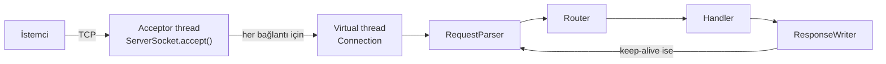

# tinyhttp

[](https://github.com/atlas-toby/tinyhttp/actions/workflows/build.yml)

Java 21 ile, hiçbir framework veya harici kütüphane kullanmadan, doğrudan `ServerSocket` üzerine yazılmış bir HTTP/1.1 sunucusu.

Amaç, Spring Boot veya Tomcat gibi araçların arka planda yaptığı işleri sıfırdan uygulamak: TCP bağlantısından gelen baytları okumak, HTTP isteğini ayrıştırmak, doğru handler'a yönlendirmek ve yanıtı protokole uygun şekilde geri yazmak.

## Özellikler

- **HTTP/1.1 istek ayrıştırıcı:** istek satırı, header'lar, `Content-Length` ile gövde okuma, query string ve percent-encoding çözme
- **Virtual thread ile eşzamanlılık:** her bağlantı kendi virtual thread'inde çalışır; handler'lar engelleyici (blocking) kod yazabilir
- **Router:** `/users/{id}` gibi yol parametreleri, `/static/*` joker karakteri, otomatik `405 Method Not Allowed` + `Allow` header'ı, `HEAD` ve `OPTIONS` desteği
- **Keep-alive ve pipelining:** tek TCP bağlantısı üzerinden art arda birden fazla istek
- **Statik dosya sunma:** MIME türü tespiti, `index.html` desteği, `../` ve sembolik link ile dizin dışına çıkma koruması
- **Güvenlik limitleri:** satır uzunluğu, header sayısı ve gövde boyutu sınırları (`414`, `431`, `413`), header injection (CRLF) koruması
- **Graceful shutdown:** yeni bağlantı kabul edilmez, boştaki bağlantılar hemen kapatılır, süren istekler tamamlanır
- **52 test:** birim testleri ve gerçek TCP bağlantısıyla uçtan uca testler

## Hızlı başlangıç

Gereksinim: JDK 21+ ve Maven.

```bash
mvn package
java -jar target/tinyhttp-1.0.0.jar 8080
```

Ardından tarayıcıda http://localhost:8080 adresini aç veya terminalden dene:

```bash
curl http://localhost:8080/hello/Eren
curl -X POST --data "ilk not" http://localhost:8080/api/notes
curl http://localhost:8080/api/notes
curl -i -X DELETE http://localhost:8080/api/notes/1
```

## Kullanım

```java
Router router = new Router()
        .get("/hello/{name}", req ->
                HttpResponse.text("Merhaba, " + req.pathParam("name").orElseThrow()))
        .post("/api/notes", req -> {
            Note note = notes.add(req.bodyAsString());
            return HttpResponse.json(note.toJson())
                    .status(HttpStatus.CREATED)
                    .header("Location", "/api/notes/" + note.id());
        })
        .get("/api/notes/{id}", req -> notes.find(id(req))
                .map(note -> HttpResponse.json(note.toJson()))
                .orElseThrow(() -> new HttpException(HttpStatus.NOT_FOUND, "Note not found")))
        .staticFiles("/", Path.of("public"));

HttpServer server = HttpServer.builder()
        .port(8080)
        .router(router)
        .maxBodyBytes(1024 * 1024)
        .readTimeout(Duration.ofSeconds(15))
        .accessLog(true)
        .build()
        .start();
```

Tam örnek: [`DemoApp.java`](src/main/java/com/erenboz/tinyhttp/demo/DemoApp.java)

## Mimari



| Sınıf | Görevi |
|---|---|
| `HttpServer` | Portu dinler, bağlantıları virtual thread'lere dağıtır, keep-alive döngüsünü ve kapanışı yönetir |
| `RequestParser` | Bayt akışını `HttpRequest` nesnesine çevirir, limitleri uygular |
| `Router` | Metot ve yola göre handler bulur, yol parametrelerini çıkarır |
| `ResponseWriter` | Durum satırını, header'ları ve gövdeyi protokole uygun yazar |
| `StaticFileHandler` | Dosya sisteminden güvenli şekilde dosya sunar |

## Tasarım kararları

**Neden virtual thread?** Klasik "her bağlantıya bir thread" modeli basittir ama platform thread'leri pahalıdır, bu yüzden binlerce bağlantıda tıkanır. NIO selector ile yazılan asenkron model ise ölçeklenir ama kodu karmaşıklaştırır. Java 21'in virtual thread'leri, basit blocking kodu korurken binlerce eşzamanlı bağlantıyı mümkün kılıyor. Testlerde 200 ms süren 100 istek, sırayla 20 saniye sürecekken birlikte yaklaşık 1 saniyede tamamlanıyor.

**Neden `Content-Length` ve `Connection` header'larını handler belirleyemiyor?** Bu iki header, bir yanıtın nerede bittiğini belirler. Handler yanlış bir değer verirse aynı bağlantıdaki sonraki yanıtlar bozulur. Bu yüzden her zaman sunucu tarafından hesaplanıyorlar.

**Neden `+` karakteri yolda boşluğa çevrilmiyor?** `URLDecoder` form kodlamasını uygular ve orada `+` boşluk anlamına gelir. URL yolunda ise `+` düz bir artı işaretidir. Ayrıştırıcı bu farkı gözetiyor.

**Neden `Router` bir `sealed interface` döndürüyor?** `Found`, `MethodNotAllowed` ve `NotFound` sonuçları Java 21'in pattern matching `switch` ifadesiyle işleniyor. Derleyici tüm durumların ele alındığını kontrol ediyor.

## Bilinçli olarak eksik bırakılanlar

- `Transfer-Encoding: chunked` istek gövdeleri (`501` döner)
- HTTPS/TLS (bir reverse proxy arkasında çalıştırılması düşünülerek)
- HTTP/2
- Büyük dosyalar için akış (streaming); statik dosyalar belleğe okunur

## Testler

```bash
mvn test
```

- `RequestParserTest`: geçerli istekler, pipelining, bozuk istek satırı, eksik `Host`, limit aşımları, geçersiz `Content-Length`
- `RouterTest`: yol parametreleri, joker karakter, 405 ve izin verilen metotlar, `HEAD` geri dönüşü, öncelik sırası
- `HttpServerTest`: gerçek TCP üzerinden uçtan uca testler; path traversal, keep-alive, eşzamanlılık ve graceful shutdown dahil

## Lisans

MIT
